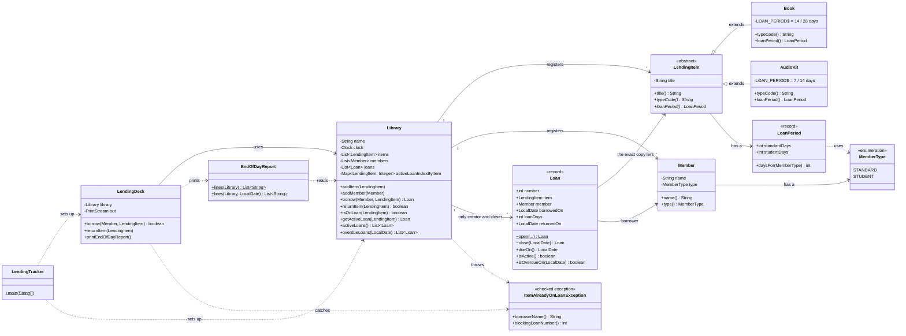

# Diagnosis: Rescue an Inherited Codebase: The Reading Room

## Issues identified in the codebase(ranked by severity)

### 1. An item can still be given out even though it has been loaned out
- `borrow()` method never checks if an item has already been loaned out. In main, Ama Owusu borrows a novel that Kofi has already loaned. The report shows the item with both Kofi Mensah(Loan #1) and Ama Owusu(Loan #3).
- **Root cause:** The loan list and status fields are separate copies. The `borrow()` method overwrites one and appends to the other without checking either
- **Business risk:** The library can't tell who has the book(Things Fall Apart) or know who has what. The item section says "Ama Owusu" and the loan list says Kofi Mensah and Ama Owusu.
- **Why this is dangerous:** It breaks the rule the business says must never be broken.

### 2. Returning an item closes every active loan with the same title

- `returnItem()` method loops over loans matching `itemTitle` and marks all of them as returned
- **Root cause:** Titles are not unique since a library can have several copies of a book.
- **Business risk:** A member can borrow a book and the system wont know the exact copy the member has. This can lead to an invisble stock loss as more copies of a paticular book are procured.

### 3. Item rules are duplicated and keyed on unchecked strings
- BOOK and AUDIO_KIT branches of `borrow()` duplicate the status update, borrower update and message. A misspelt type wont match either othe two branches, hence the item will stay available.
- **Root cause:** The rules for both items are tangled in one method.
- **Business risk:** Every change to one item type would mean editing the method all the item types share. 

### 4. No encapsulation
- Every field is public and mutable.
- **Root cause:** The classes just hold the values while the rules live in separate code that can be bypassed.
-**Business risk:** Every feature that is implemented has a chance to bypass the lending rules.

### 5. No dates listed
- There are no borrow dates or due dates.
- **Business risk** The library can't tell which items are overdue, this is the main reason why loans are tracked.

## Design sketch

_Added after the first code change; the structure below is what was built._

### Packages

```
com.amalitech.training.readingroom
├── LendingTracker        entry point: sets up the library and replays the afternoon
├── item/                 WHAT can be lent
│   ├── LendingItem       abstract: every item has a title and a loan rule
│   ├── Book              14 days standard / 28 student
│   ├── AudioKit          7 days standard / 14 student
│   └── LoanPeriod        record: the two loan lengths for one kind of item
├── member/               WHO borrows
│   ├── Member            name + membership type
│   └── MemberType        enum: STANDARD, STUDENT
├── library/              THE RULES
│   ├── Library           the only place loans are opened and closed
│   ├── Loan              record: one loan, never changed after it is created
│   └── ItemAlreadyOnLoanException
├── desk/                 WHAT THE VOLUNTEER SEES
│   └── LendingDesk       prints the same messages as the original
└── report/
    └── EndOfDayReport    builds the end-of-day report lines
```

### Class diagram


